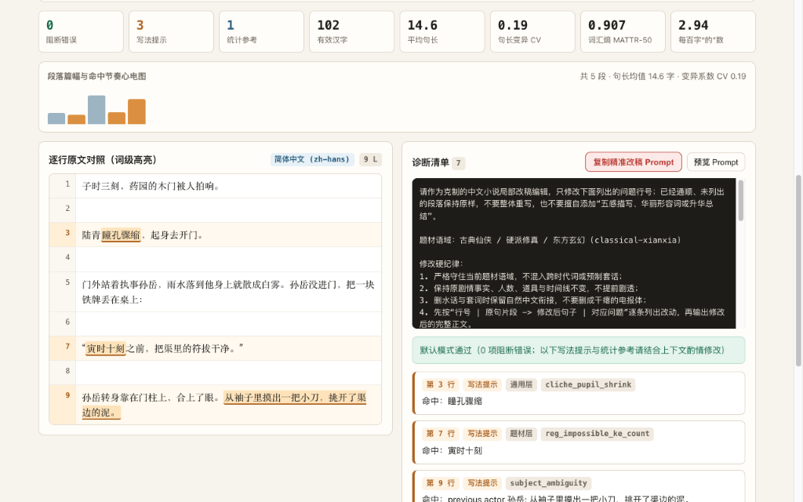
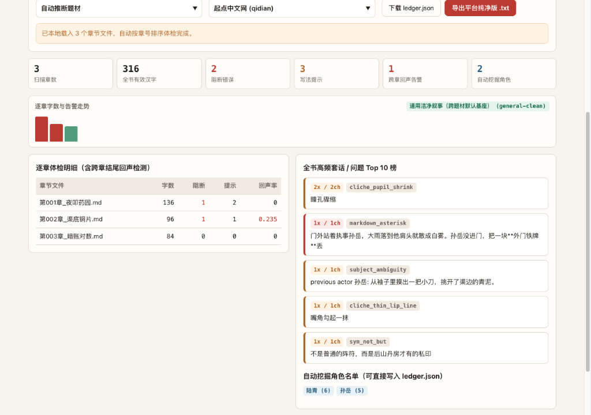
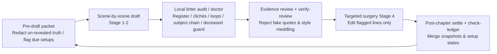

# InkBone

**A living ledger, style contract, and zero-dependency QA engine for writing Chinese long-form fiction with LLMs.**

[](https://www.npmjs.com/package/inkbone)
[](https://blankym.github.io/inkbone/)
[](https://github.com/blankym/inkbone/actions/workflows/test.yml)
[](package.json)
[](https://nodejs.org)
[](LICENSE)

[中文](README.md) · **[Live Playground & Browser Doctor](https://blankym.github.io/inkbone/)** · **[npm](https://www.npmjs.com/package/inkbone)** · **[Discussions](https://github.com/blankym/inkbone/discussions)** · 9 genre packs · Offline 280-Char AIGC Guard · Simplified + Traditional Chinese · Zero-Dep `.docx` / `.zip` Export · Full MCP Server · VS Code Extension · 80 tests

> **Language note:** Prompts, rule patterns, and CLI findings target **Chinese long-form fiction** (both Simplified and Traditional Chinese). This README documents the architecture and workflow in English.

---

## Pick Your Entry Point in 10 Seconds

| How you write | Fastest way to start | What you get immediately |
| :--- | :--- | :--- |
| **Web LLMs (DeepSeek / Claude / Gemini)**<br/>*(zero setup)* | Open **[Live Playground & Browser Doctor](https://blankym.github.io/inkbone/)** | Drop a chapter or an entire `chapters/` folder (**100% client-side, zero uploads**) → word-level highlights with **double-click inline editing**, cross-chapter echo ranking, **one-click targeted rewrite prompt**, and clean `.txt` / **submission `.docx`** / **bundled `.zip`** export |
| **Claude Code / Codex / Antigravity / OpenCode** | `npx skills add blankym/inkbone` | 8-stage fiction workflow + offline 280-char AIGC structural guard + spoiler-safe living ledger + local linting + 9 genre playbooks |
| **Claude Desktop / Cursor / Windsurf (MCP)** | Add `npx -y inkbone mcp` | One config loads **10 Tools + 8 Prompts + 11 Resources** — no separate skill setup needed |
| **VS Code / Cursor & Terminal CLI** | `npx inkbone audit ch01.md` or install [VS Code Extension](editors/vscode-inkbone/) | Clone-free CLI checkups, copyright-safe style profiling, live squiggly diagnostics, **character ledger Hover cards**, and **status-bar platform word-count delta** |

---

## Why InkBone?

Long-form LLM fiction usually breaks down around chapter 15:

- Setups planted in chapter 3 get forgotten or spoiled in narration forty chapters later, or a character killed in chapter 12 casually walks back into dialogue in chapter 38.
- Classical xianxia prose starts slipping in modern slang, impossible traditional time counts, and repetitive stock tics.
- Subject-dropped Chinese action sentences silently shift actors right after another character's line.
- Ask a model to review its own draft and it often invents quotes that never existed while nudging you to "add more sensory adjectives."

Longer prompts cannot enforce themselves once rules drift out of context. **InkBone separates generative drafting from deterministic verification**: staged prompts align pacing and voice before writing, while a zero-dependency local engine verifies lexicons, ledger boundaries, calendars, and subject chains line by line afterward.

### Client-Side Playground & Whole-Book Browser Doctor (Zero Uploads)



> **Tab 1 (Single Chapter Audit)** runs pure ES Modules inside your browser: drag-and-drop `.md`/`.txt`, automatic Simplified/Traditional Chinese rule switching, inline `<mark>` highlights, double-click inline editing, Golden-Three & **offline 280-char AIGC window guard (`--aigc-guard`)** toggles, paragraph rhythm strip, and a **one-click targeted rewrite prompt** ready to paste back into any web LLM.



> **Tab 4 (Browser Doctor)** accepts an entire `chapters/` directory: automatically sorts chapters (Arabic or Chinese numerals), scores cross-chapter echo rate and book-wide Top 10 clichés, exports an auto-mined `ledger.json`, and cleans chapters into platform-ready `.txt` bundles.

### How It Differs from Pure-Prompt Writing Kits

| Area | Typical Prompt-Only Kits | InkBone v2.1 |
| :--- | :--- | :--- |
| **Register & Cliché Control** | Relies on LLM willpower; drifts after a few thousand characters | **Deterministic code linter** with 9 genre packs, Simplified/Traditional auto-detection, and project overrides |
| **Continuity & Anti-Spoiler** | Stuffs the entire outline into context and leaks twists early | **Living Ledger (`packet` + `settle` + `check-ledger`)**: redacts un-revealed `fullTruth` as `[REDACTED]` and guards against deceased characters reappearing |
| **Review Grounding** | Models hallucinate quotes and rewrite your voice | **`verify-review` hard gate**: rejects any review item missing verbatim text or giving stylistic meddling advice |
| **Friction & Privacy** | Locked to one IDE or requires cloud uploads | **Static zero-upload web app** + `npx` CLI + zero-dependency MCP server + VS Code linter |
| **Quality Metric** | Easily degenerates into gaming AIGC detectors | **Never edits to chase detector scores**; optimizes for human blind reading (`eval-pack` / `eval-score`) |

---

## See It Catch Real Issues in 30 Seconds



Save a 9-line sample chapter (`ch01.md`):

```markdown
子时三刻，药园的木门被人拍响。

陆青瞳孔骤缩，起身去开门。

门外站着执事孙岳，雨水落到他身上就散成白雾。孙岳没进门，把一块铁牌丢在桌上：

“寅时十刻之前，把渠里的符拔干净。”

孙岳转身靠在门柱上，合上了眼。从袖子里摸出一把小刀，挑开了渠边的泥。
```

Add a character roster (`ledger.json`):

```json
{ "characterNames": ["陆青", "孙岳"] }
```

Run directly via `npx` (Node.js 18+, no clone or API key needed):

```bash
npx inkbone doctor ch01.md --genre classical-xianxia --ledger ledger.json --skip-length --lang en
```

Output:

```markdown
## ch01.md
- **L3**: `cliche_pupil_shrink` (瞳孔骤缩)
- **L7**: `reg_impossible_ke_count` (寅时十刻)
- **L9**: `subject_ambiguity` (previous actor 孙岳: 从袖子里摸出一把小刀，挑开了渠边的泥。)
```

- **Line 3**: flags a stock AI cliché in narration while leaving quoted dialogue untouched.
- **Line 7**: catches a calendar error (a traditional *shichen* only has 8 *ke*, never 10).
- **Line 9**: sees Sun Yue (`孙岳`) opened the prior sentence and warns that the following subjectless action reads as Sun Yue pulling the knife.

### Before / After in Practice

```markdown
Before (typical AI draft):
Forty-three-year-old veteran Zhou Jianmin ran the old-town delivery station and worried about cutting complaints before month-end. Taking a deep breath with a bitter smile, he pushed open the glass door so no one would see his unease.

After (cut resume dump, stock tics, and explanatory tail):
The complaint rate sat at 0.62%, well above the district cutoff. Zhou flattened the appeal sheets, pulled his yellow raincoat off the hook. Outside under the awning, Hu Fei tapped "decline" two rings into a dispatch alert.
```

### Reproducible Public Benchmark (4 Original Seeds)

Run `node scripts/run-public-eval.mjs` to reproduce [benchmarks/public-report.md](benchmarks/public-report.md) on the 4 original zero-copyright pairs in [benchmarks/eval-set/public-pairs.json](benchmarks/eval-set/public-pairs.json):

| Seed | Genre | Baseline (Errors / Warnings / Line Hits) | InkBone Revised (Errors / Warnings / Line Hits) |
| :--- | :--- | :---: | :---: |
| Herb Ditch (`xianxia-herb-ditch`) | `classical-xianxia` | 0 / 5 / 13 | 0 / 0 / 0 |
| Fog Harbor (`mystery-harbor-coroner`) | `mystery-thriller` | 1 / 5 / 12 | 0 / 0 / 0 |
| Delivery Station (`urban-delivery-station`) | `urban-realism` | 0 / 4 / 8 | 0 / 0 / 0 |
| Cooling-Off Day (`romance-cooling-off`) | `romance-emotional` | 0 / 3 / 14 | 0 / 0 / 0 |
| **Total (4 genres)** | — | **1 / 17 / 47** | **0 / 0 / 0** |

---

## 4 Ways to Get Started

### Path 1: Browser Playground (Zero Setup)

Open **[https://blankym.github.io/inkbone/](https://blankym.github.io/inkbone/)**:

1. **Single-Chapter Audit (Tab 1)**: paste or drop a `.md`/`.txt` chapter, pick a genre (Traditional Chinese switches automatically), inspect inline highlights and rhythm strip;
2. **Targeted Rewrite**: click **Copy Targeted Rewrite Prompt** and paste it into DeepSeek / Claude / Gemini so the model only patches flagged line numbers;
3. **Whole-Book Browser Doctor (Tab 4)**: select an entire `chapters/` folder to inspect cross-chapter echoes, book-wide Top 10 clichés, download an auto-mined `ledger.json`, or export clean `.txt` files for Qidian / Fanqie / Qimao / JJWXC.

### Path 2: One-Line Agent Skill (`npx skills add`)

`skills/inkbone/` follows the open `agentskills` spec and bundles `SKILL.md`, the CLI, configs, 8 stage prompts, and craft playbooks:

```bash
npx skills add blankym/inkbone
```

Or copy offline:

```bash
git clone https://github.com/blankym/inkbone.git
cp -R inkbone/skills/inkbone <your-skills-dir>/inkbone
```

Then just talk to your agent:
- "Set up a mystery novel project with InkBone and generate `novel.json` and `ledger.json`."
- "Compile the chapter 12 packet from `ledger.json`, outline the scene beats, and settle the ledger once drafted."
- "Import `chapters/` into a ledger with auto-mined character names and run `doctor` across all volumes."

### Path 3: Zero-Dependency MCP Server, Hooks & VS Code Extension

InkBone ships a **zero-dependency stdio MCP server** exposing:
- **10 Tools**: `inkbone_audit`, `inkbone_doctor`, `inkbone_aigc_check`, `inkbone_packet`, `inkbone_settle`, `inkbone_check_ledger`, `inkbone_verify_review`, `inkbone_normalize`, `inkbone_style_profile`, `inkbone_export`;
- **8 Stage Prompts**: `inkbone/style-architect` through `inkbone/chapter-settler` (passing `genre` automatically attaches the matching playbook);
- **11 Read-Only Resources**: `inkbone://playbooks/<genre>` (9 playbooks), micro-techniques guide, and 10 before/after cases.

Add to Claude Desktop / Cursor / Windsurf (see [examples/mcp-config.json](examples/mcp-config.json)):

```json
{
  "mcpServers": {
    "inkbone": {
      "command": "npx",
      "args": ["-y", "inkbone", "mcp"]
    }
  }
}
```

- **Claude Code auto-gate**: run audits automatically on chapter edits via [examples/claude-code-hooks.json](examples/claude-code-hooks.json).
- **VS Code / Cursor real-time linter**: inline squigglies, Quick Fixes (strip asterisks / add to whitelist), rewrite prompt copy, and platform export in [editors/vscode-inkbone/](editors/vscode-inkbone/).

### Path 4: Standalone CLI (`npx` / Global Install / Offline Clone)

Requires **Node.js 18+**, zero dependencies:

```bash
# Run immediately via npx
npx inkbone --help

# Or install globally
npm install -g inkbone

# Or run offline from git clone (no npm install required)
git clone https://github.com/blankym/inkbone.git && cd inkbone
node bin/inkbone.mjs --help
```

Four everyday workflows (replace `npx inkbone` with `inkbone` if installed globally):

1. **30-second chapter check, offline 280-char AIGC window guard & rewrite prompt (Simplified + Traditional Chinese auto-detected)**
   ```bash
   npx inkbone audit ch01.md --genre urban-realism --format md --lang en --no-project --no-ledger --skip-length
   npx inkbone aigc-check ch01.md
   npx inkbone rewrite-prompt ch01.md --genre urban-realism --aigc-guard --lang en --no-project --no-ledger --skip-length
   ```
2. **Copyright-safe style profiling + living ledger loop**
   ```bash
   # Extracts statistics-only pacing profiles & customGates without copying source prose
   npx inkbone style-profile ./ref-samples --out ./my-novel/style.json
   npx inkbone init ./my-novel --genre classical-xianxia --title "BookTitle"
   npx inkbone packet --ledger ./my-novel/ledger.json --chapter 4 --prev ./my-novel/ch03.md
   npx inkbone settle --ledger ./my-novel/ledger.json --patch ./my-novel/ch04-settlement.json
   npx inkbone check-ledger ./my-novel/ledger.json --current 4
   ```
3. **Batch ledger backfill & incremental long-form checkup (`--chapters` / `--changed`)**
   ```bash
   npx inkbone import-ledger ./my-novel/chapters --auto-characters --out ./my-novel/ledger.json --title "BookTitle"
   npx inkbone backfill-prompt ./my-novel/chapters --ledger ./my-novel/ledger.json --batch-size 5 --limit 1
   npx inkbone settle --ledger ./my-novel/ledger.json --patch ./my-novel/batch-settlement.json --batch
   npx inkbone doctor ./my-novel/chapters --chapters 40-45 --lang en
   npx inkbone doctor ./my-novel/chapters --changed --lang en
   ```
4. **Export clean chapters, editorial submission `.docx`, and `.zip` bundles (`qidian`, `fanqie`, `qimao`, `jjwxc`)**
   ```bash
   npx inkbone export ./my-novel/chapters --platform qimao --out ./dist/qimao --merge-out ./dist/vol1.txt --docx-out ./dist/submission.docx --zip-out ./dist/chapters.zip --outline ./my-novel/outline.md --title "BookTitle"
   ```

---

## Workflow & Core Engine

The `prompts/` directory defines eight stages (`00`–`07`), with CLI/MCP enforcing deterministic gates between stages:

1. **Register contract (`00-style-architect.md`)**: derives the genre pack, three-tier character voice matrix, and banned terms into `novel.json`.
2. **Beat plan (`01-beat-planner.md`)**: pulls spoiler-safe context via `packet`, lays out information placement and scene beats, and pauses for author sign-off before drafting. `check-outline` catches leftover `[待补充]` placeholders.
3. **Drafting (`02-paratactic-renderer.md`)**: continues directly from the prior chapter's ending state without echoing the previous ending or copying beat-sheet prose.
4. **Local audit (`audit` / `doctor`)**: reports blocking errors and line-level warnings (Chinese default, `--lang en` supported, auto Simplified/Traditional detection).
5. **Grounded review (`04`, `05` + `verify-review` / `review-save`)**:
   - `04-evidence-reviewer.md` audits causality, timelines, physics, and character motivation.
   - `05-reader-simulator.md` runs two passes: a cold reader with zero lore context, and a genre veteran scanning for drag or register slips.
   - `verify-review` rejects any item whose quote is absent from the chapter or whose feedback meddles with prose style.
6. **Targeted revision (`03-targeted-rewriter.md`)**: edits only verified review items and flagged line numbers, then re-audits.
7. **Post-chapter settlement & ledger health (`07-chapter-settler.md` + `settle` / `check-ledger`)**: non-destructively merges chapter summaries, 8-field character snapshots, and foreshadowing state transitions into `ledger.json`, flagging overdue setups before the next chapter starts.
8. **Post-freeze scan (`detect`, optional)**: records one external scan after locking the chapter; never loops to chase detector scores.

### What It Checks

| Area | Examples | Default level |
| :--- | :--- | :--- |
| Ledger, tactical props & world rules | Missing required anchors, premature spoilers before `revealChapter`, deprecated terms, opening echoing the prior ending; **deceased/departed characters acting or speaking outside flashbacks (`DECEASED_CHARACTER_APPEARANCE`)**; **short-term tactical props past `mustResolveByChapter` (`UNRESOLVED_TACTICAL_PROP`)**; **executable world-rule invariants (`WORLD_RULE_VIOLATION`)**; **numeric resource ledger balance continuity (`RESOURCE_LEDGER_MISMATCH`)** | `error` / `warning` |
| Format, length & calendar claims | Markdown asterisks, inline ledger notes like `(余13滴)`, mismatched quote-length claims; **intra-chapter lunar calendar span contradicting "half a month" claims (`CALENDAR_SPAN_CONTRADICTION`)** | `error` / `warning` |
| Golden-three opening retention | With `--golden-three`, flags slow openings (first 380 Han chars) that lack spoken dialogue and immediate conflict/action signals (`GOLDEN_OPENING_SLOW_START`) | `warning` |
| Model degeneration | Verbatim line/sentence loops, truncated endings, garbled characters, AI refusal/meta-leakage | `error` / `warning` |
| Subject continuity | Subjectless action right after another character's action; three consecutive paragraphs opening the same way | `warning` |
| Register & script variant | Modern slang in period settings, invalid traditional time counts, archaic phrasing in urban fiction; **auto Simplified/Traditional Chinese & HK/TW web-novel rules** | `warning` (escalates on high density) |
| Clichés & density | Stock micro-acting phrases, symmetric skeletons, panel dossier recitation, excessive similes/exclamation marks/ellipses, telegraphic over-compression guard | `warning` (escalates on high density) |
| Offline AIGC window guard | `aigc-check` or `--aigc-guard` scans 280-char windows for `N/A/Q/S/M` paragraph cadence entropy, sandwich-quote (`SSS`) streaks, U-shaped `的` starvation rebound, narration `这/那` demonstrative spikes, and `>=6`-char compound modifier bricks | `warning` / `info` |
| Statistical fingerprint | 20+ metrics (MATTR-50, sentence-length CV, cadence entropy, `的`-modifier density) compared against human reference ranges | `info` (diagnostic only) |

Warnings exit `0` for human judgment; hard errors and high-frequency blocking violations exit non-zero for CI. Pass `--strict` to fail on all gates.

### Three-Layer Rules

`audit` and `doctor` walk upward from chapter files to discover `novel.json` and merge three rule layers:

1. **Universal (`configs/zh-linguistics.json`, `configs/zh-traditional.json`)**: cross-genre clichés, filler phrases, punctuation, and Simplified/Traditional hygiene.
2. **Genre (`configs/genres.json`)**: 9 built-in genre packs catching cross-genre register leakage.
3. **Project (`novel.json` + `.inkbone-whitelist`)**: book-specific vocabulary, `customGates` from `style-profile`, literal whitelists, and `disabledRuleIds`.

Before promoting a rule above the project layer, run `npx inkbone rule-stats --human <human-corpus> --ai <ai-drafts>` to confirm human authors do not write the same pattern frequently.

---

## Built-in Fiction Craft Library (`resources/`)

Beyond deterministic linting, InkBone bundles practical plotting and editing guides (loaded on demand per stage so prompts stay lean):

- **[Micro-Techniques & Revision Lookup (`resources/micro_techniques.md`)](resources/micro_techniques.md)**: action-reaction "two-press, one-lift" beats, 80/20 climax framing, multi-purpose foreshadowing, post-climax three-part loot settlements, anti-bloat discipline, and a 9-symptom revision lookup table.
- **[10 Before/After Case Studies (`resources/bad_vs_good_cases.md`)](resources/bad_vs_good_cases.md)**: side-by-side rewrites covering micro-action trimming, late-in/early-out dialogue, dialogic panel/ledger delivery, anti-rebound cadence variety, and avoiding telegraphic over-compression.
- **[9 Genre Playbooks (`resources/genre_playbooks/`)](resources/genre_playbooks/)**: dedicated playbooks for xianxia, historical court, wuxia, mystery/thriller, urban realism, sci-fi wasteland, light fantasy, romance, and clean general fiction.

---

## Genre Packs & 27-Command Reference

<details>
<summary>Expand 9 built-in genre packs (run <code>npx inkbone genres</code> to inspect)</summary>

- `classical-xianxia`: classical cultivation and xianxia
- `historical-court`: historical intrigue and period drama
- `wuxia-jianghu`: traditional martial-arts fiction
- `mystery-thriller`: crime, folklore horror, and rule-based suspense
- `urban-realism`: contemporary urban, workplace, and realistic drama
- `scifi-wasteland`: sci-fi, cyberpunk, and post-apocalyptic survival
- `light-fantasy`: brisk light-novel / system comedy
- `romance-emotional`: historical and contemporary romance
- `general-clean`: neutral cross-genre baseline

</details>

| Group | Command | Purpose |
| :--- | :--- | :--- |
| Living ledger | `genres` / `init` | List all 9 genre packs / scaffold `novel.json` and `ledger.json` |
| | `import-ledger` / `backfill-prompt` | Scan existing chapters, mine candidate character names & merge ledger / emit batched `settle --batch` prompts for unsettled chapters |
| | `packet` | Compile spoiler-safe context with un-revealed `fullTruth` redacted and optional snapshot pruning |
| | `check-ledger` / `settle` | Validate ledger health, tactical props & resource balances / merge single or `--batch` settlement JSON cleanly |
| Format & QA | `normalize` / `check-outline` | Strip asterisks & normalize dashes / verify Stage 1 beat outlines |
| | `audit` / `doctor` | Single-chapter audit (Simplified/Traditional + deceased/world-rule/golden-three/`--aigc-guard` guards) / full or incremental checkup (`--chapters` / `--changed`) |
| | `aigc-check` / `rewrite-prompt` | Zero-token 280-char sliding-window AIGC structural & lexical guard / emit a copy-ready targeted rewrite prompt for web LLMs |
| Style & publish | `style-profile` / `export` | Copyright-safe statistical style profiler / clean `.txt`, **editorial `.docx`**, and **`.zip`** export for `qidian`, `fanqie`, `qimao`, `jjwxc` |
| Protocol | `mcp` | Start the zero-dependency stdio MCP server (10 tools, 8 prompts, 11 resources) |

<details>
<summary>Expand review, blind evaluation & rule calibration commands (11 advanced commands)</summary>

| Group | Command | Purpose |
| :--- | :--- | :--- |
| Review & blind eval | `verify-review` | Verify that review quotes exist verbatim in the chapter and reject style meddling |
| | `review-save` | Verify and archive a review JSON with chapter SHA-256 and model metadata |
| | `review-stats` | Compare issue counts and skip points across saved review revisions |
| | `eval-pack` | Build an anonymized X/Y blind reading packet alongside a private `key.json` |
| | `eval-score` | Tally blind reader ballots with win rates, sign-test p-values, and skip-quote verification |
| Calibration & logs | `profile` | Compute 20+ linguistic fingerprint metrics for a chapter |
| | `calibrate` | Generate statistics-only p10/median/p90 reference ranges from a human corpus |
| | `rule-stats` | Measure per-rule hit rates per 10k characters across human vs. AI texts |
| | `mine` | Extract 3/4-gram phrases overused in AI drafts compared to human prose |
| | `detect` | Run a single cached external scan (requires `.env` API key), record-only |
| | `benchmark` | Compare corpus metrics against manifest entries |

</details>

Run `npx inkbone --help` for daily commands, or `npx inkbone --help-all` for all 27 commands.

---

## Layout & Development

```text
bin/  src/         CLI, zero-dependency core engine (AIGC window guard, style profiler, DOCX/ZIP exporter, Browser Doctor) & full MCP server
configs/           Universal rules, 9 genre packs, Traditional Chinese layer, 4 platform presets, gates & zh/en catalog
docs/              Browser-only static playground (double-click inline editing + AIGC window guard) & Browser Doctor (.docx / .zip export)
editors/           Standalone zero-dependency VS Code / Cursor real-time linter + ledger Hover cards & word-count status bar
examples/          MCP client config & Claude Code PostToolUse Hook templates
prompts/           8 staged drafting, review & settlement prompts (00–07)
resources/         Before/after examples, micro-techniques, 9 genre playbooks, eval guide
benchmarks/        4 original eval seeds, de-identified AIGC window calibration pairs & reproducible comparison report
evals/             Runtime-agnostic skill trigger eval set
skills/inkbone/    Generated self-contained skill package (do not edit directly)
tests/             80 unit tests
```

```bash
npm test               # Run all 80 tests (zero-Han-literal, 280-char AIGC guard, full MCP, zh-hant, DOCX/ZIP export, VS Code core, docs & skill sync)
npm run build:skill    # Repackage skills/inkbone after editing sources/configs/prompts/README
npm run check:skill    # Verify skills/inkbone matches sources (enforced in CI)
npm run build:docs     # Sync browser playground docs/vendor after editing src/core or configs
npm run check:docs     # Verify docs/vendor matches sources (enforced in CI)
```

## Contributing, Acknowledgments & License

Try a real draft in the **[Live Playground](https://blankym.github.io/inkbone/)**, and feel free to report false positives or propose new genre rules:

- **Discussions & Showcase**: [GitHub Discussions](https://github.com/blankym/inkbone/discussions)
- **Report False Positive / Propose Rule**: [Issue Forms](https://github.com/blankym/inkbone/issues/new/choose)
- **Community Link & Acknowledgment**: InkBone is 100% open source and appreciates the open-source sharing spirit and early testing feedback from the [LINUX DO](https://linux.do/) community ([https://linux.do/](https://linux.do/)).
- **Inspirations**:
  - Chapter boundary isolation and verbatim-quote review checks inspired by [EthanYoQ/Pagekin](https://github.com/EthanYoQ/Pagekin)
  - Chinese clause-trunk and symmetric-frame checks inspired by [LifelongLazyLearner/qu-ai-wei](https://github.com/LifelongLazyLearner/qu-ai-wei)
  - Rhetorical density grading, degeneration detection, and meta-leak checks inspired by [zenstory-ai/oh-story-claudecode](https://github.com/zenstory-ai/oh-story-claudecode)

Released under the [MIT License](LICENSE), including all rule configurations and playbooks.
