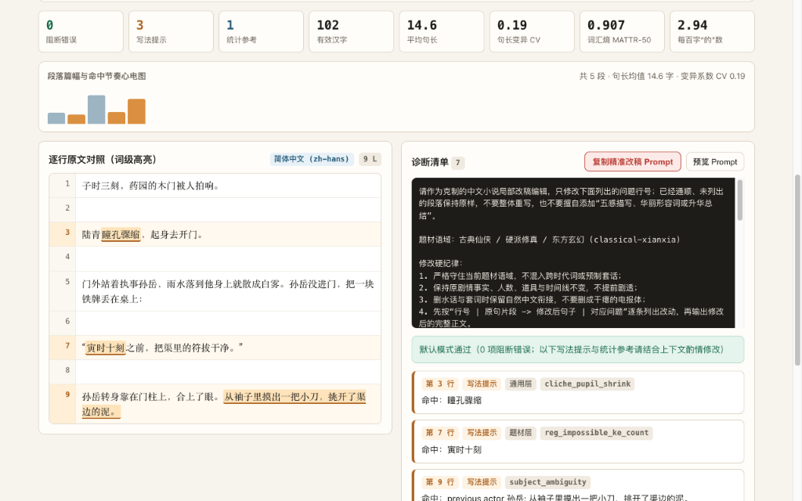
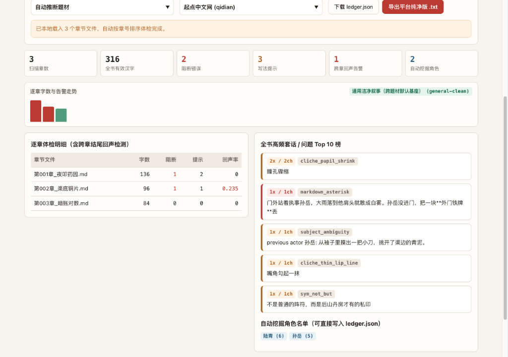
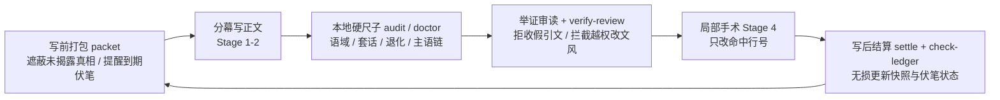

# InkBone（墨骨）

**给大模型配一本不会忘事的账本和一把改稿尺子，用来写中文长篇连载小说。**

[](https://github.com/blankym/inkbone/actions/workflows/test.yml)
[](LICENSE)
[](https://nodejs.org)
[](package.json)
[](package.json)

[English](README.en.md) · **[在线试跑台 / 整书体检（纯浏览器本地）](https://blankym.github.io/inkbone/)** · 9 个题材包 · 简繁自动识别 · 25 条命令 · MCP 三件套 · VS Code 实时扩展 · 66 项测试 · 零第三方依赖

用大模型写长篇连载，头三章看着还行，写到十几章毛病就全出来了：

- 前面埋的伏笔写到第 40 章自己忘了，或者把第 60 章才揭的底提前漏在旁白里；
- 仙侠文里突然冒出“降维打击”“寅时十刻”，每章必来一遍“瞳孔骤缩”“空气凝固”；
- 上一句主语是配角，下一句省了主语直接写动作，读者读成配角动的手；
- 让模型自己审稿，它张口就编一段原文里找不到的引文，顺手劝你“多加五感描写和形容词”。

这些问题靠把提示词写长管不住，模型自己写完就忘了。InkBone 把流程拆开：写之前靠分阶段提示词把规矩和节拍对齐，写完以后交给本地 Node 脚本按词表、台账和上下文逐行检查。

---

## 30 秒看它能抓出什么

> **不想装环境，或者只用网页端 DeepSeek / Claude / Gemini 写小说？** 直接打开 **[在线试跑台 & 整书体检台](https://blankym.github.io/inkbone/)** —— 纯前端 ES Module 在浏览器本地运行，正文绝不上传服务器；支持：
> - **单章体检**：本地 `.md`/`.txt` 拖拽导入、简繁自动识别（含港台網文繁體規則）、原文词级 `<mark>` 高亮、段落节奏心电图、**一键复制精准改稿 Prompt**；
> - **整书多章体检（Browser Doctor · Tab 4）**：一次选择或拖入整个 `chapters/` 文件夹，自动按章号排序跑跨章回声体检、全书高频套话 Top 10 榜、一键下载含自动挖掘角色的 `ledger.json`、一键按起点/番茄/七猫/晋江导出纯净投稿版 `.txt`；
> - **活账本防剧透与审读核验**：`packet` / `check-ledger` / `verify-review` 实时演示。



<details>
<summary>点击展开查看 Tab 4：纯浏览器整书多章体检（Browser Doctor）与平台投稿导出实机界面</summary>



</details>



准备一段 9 行的测试稿 `ch01.md`：

```markdown
子时三刻，药园的木门被人拍响。

陆青瞳孔骤缩，起身去开门。

门外站着执事孙岳，雨水落到他身上就散成白雾。孙岳没进门，把一块铁牌丢在桌上：

“寅时十刻之前，把渠里的符拔干净。”

孙岳转身靠在门柱上，合上了眼。从袖子里摸出一把小刀，挑开了渠边的泥。
```

再写一份只有人名的台账 `ledger.json`：

```json
{ "characterNames": ["陆青", "孙岳"] }
```

本地直接运行（无需联网，无需 `npm install`）：

```bash
node bin/inkbone.mjs doctor ch01.md --genre classical-xianxia --ledger ledger.json --skip-length
```

终端输出：

```markdown
## ch01.md
- **L3**: `cliche_pupil_shrink` (瞳孔骤缩)
- **L7**: `reg_impossible_ke_count` (寅时十刻)
- **L9**: `subject_ambiguity` (previous actor 孙岳: 从袖子里摸出一把小刀，挑开了渠边的泥。)
```

- **第 3 行**：常见套话，只扫描引号外叙述（角色台词里正常说话不误报）；
- **第 7 行**：古代一个时辰只有八刻，“寅时十刻”直接标出历法穿帮；
- **第 9 行**：上一句开头是“孙岳”，这一句没写主语就接着写动作，程序顺着主语链往回读一遍，标出“这里读者会以为摸刀的是孙岳”。

### 顺手看一段实际改稿效果

```markdown
改前（常见 AI 起手）：
周建民今年四十三岁，退伍后一直守在老城区外卖站，心里盘算着月底前必须把差评压下去。他深吸一口气，嘴角露出一丝苦笑，推开玻璃门走了出去，免得被人看出异样。

改后（砍掉履历旁白、微动作套词和解释尾巴）：
屏幕右上角差评率挂在 0.62%，离片区红线还高一截。周建民把退单申诉表按平，扯下挂钩上的黄雨衣套上。门外胡飞正蹲在雨棚下抽烟，手机接单声刚响了两下就按了挂起。
```

### 公开可复现评测对比（4 题材原创种子）

使用完全原创、零版权风险的公开测试对 [benchmarks/eval-set/public-pairs.json](benchmarks/eval-set/public-pairs.json)（可运行 `node scripts/run-public-eval.mjs` 随时复现，完整报告见 [benchmarks/public-report.md](benchmarks/public-report.md)）：

| 原创测试种子 | 题材包 | 典型 AI 初稿（阻断 / 提示 / 行命中） | InkBone 修订稿（阻断 / 提示 / 行命中） |
| :--- | :--- | :---: | :---: |
| 药园沟渠 | `classical-xianxia` | 0 / 5 / 13 | 0 / 0 / 0 |
| 雾港夜班 | `mystery-thriller` | 1 / 5 / 12 | 0 / 0 / 0 |
| 城中村站长 | `urban-realism` | 0 / 4 / 8 | 0 / 0 / 0 |
| 冷静期最后一天 | `romance-emotional` | 0 / 3 / 14 | 0 / 0 / 0 |
| **合计（4 题材）** | — | **1 / 17 / 47** | **0 / 0 / 0** |

---

## 安装与上手

需要 **Node.js 18+**，无第三方依赖。

### 方式一：一行命令装成 Agent Skill（推荐）

`skills/inkbone/` 遵循 `agentskills` 开放规范，自包含 `SKILL.md`、CLI、配置、8 个阶段提示词与方法库。支持 Claude Code、Codex、Cursor、Antigravity 等宿主一键安装：

```bash
npx skills add blankym/inkbone
```

也可以离线手动拷贝：

```bash
git clone https://github.com/blankym/inkbone.git
cp -R inkbone/skills/inkbone <你的 skills 目录>/inkbone
```

装好以后，在对话里直接按平常说话的方式提需求就行，例如：
- **开新书**：“我要写一本悬疑民俗长篇，先帮我定语体和世界观规则，建好 `novel.json` 和 `ledger.json`。”
- **写新章**：“按台账排第 12 章的节拍表，先给我确认再动笔；定稿后帮我跑完结算更新台账。”
- **接手半截书稿**：“帮我给 `chapters/` 建台账并自动提取出场人物，跑一遍体检，把逻辑漏洞和 AI 味重的段落标出来。”

> 如果所用平台禁用了命令行执行，提示词部分（`prompts/` 与 `resources/`）仍可照常使用，只需注意脚本类检查不会自动运行。

### 方式二：接入零依赖 MCP 三件套（Tools + Prompts + Resources）与 Hooks

InkBone 内置**零第三方依赖**的完整 `stdio MCP Server`，仅需挂载一个 MCP 即可同时获得 **9 个结构化工具**（含 `inkbone_style_profile`、`inkbone_export`）、**8 个阶段提示词 Prompts**（如 `inkbone/beat-planner`，传入 `genre` 自动拼附题材剧本卡）与 **11 份只读写作知识 Resources**（`inkbone://playbooks/<genre>` 与微技法手册），连 Skill 都无需重复配置（完整样例见 [examples/mcp-config.json](examples/mcp-config.json)）：

```json
{
  "mcpServers": {
    "inkbone": {
      "command": "npx",
      "args": ["-y", "inkbone", "mcp"]
    }
  }
}
```

- 如需在 Claude Code 修改章节后自动触发审计门禁，见 [examples/claude-code-hooks.json](examples/claude-code-hooks.json)。
- 如需在 **VS Code / Cursor** 中边写边实时划波浪线（中文小说 ESLint）与一键 Quick Fix，见独立零依赖扩展 [editors/vscode-inkbone/](editors/vscode-inkbone/)。

### 方式三：本地命令行（支持 `npx` 零克隆或离线运行）

```bash
# 方式 A：通过 npm 直接试跑或全局安装（npm 发布后可用）
npx inkbone audit ch01.md --genre classical-xianxia --format md --skip-length
# 或 npm install -g inkbone

# 方式 B：离线克隆直接跑（无需 npm install）
git clone https://github.com/blankym/inkbone.git
cd inkbone
node bin/inkbone.mjs --help       # 展示高频日常命令
node bin/inkbone.mjs --help-all   # 展示全部 25 条命令
```

四条最常用的起步路径：

1. **单章 30 秒快检 & 一键生成改稿 Prompt（自动支持简体 / 繁體）**
   ```bash
   node bin/inkbone.mjs audit ch01.md --genre urban-realism --format md --no-project --no-ledger --skip-length
   node bin/inkbone.mjs rewrite-prompt ch01.md --genre urban-realism --no-project --no-ledger --skip-length
   ```
2. **安全拆书定风格 + 新书活账本闭环**
   ```bash
   # 零原文泄露，基于范文或前 20 章提取节奏画像与可直接写入 novel.json 的 customGates
   node bin/inkbone.mjs style-profile ./ref-samples --out ./my-novel/style.json
   node bin/inkbone.mjs init ./my-novel --genre classical-xianxia --title "书名"
   node bin/inkbone.mjs packet --ledger ./my-novel/ledger.json --chapter 4 --prev ./my-novel/ch03.md
   node bin/inkbone.mjs settle --ledger ./my-novel/ledger.json --patch ./my-novel/ch04-settlement.json
   node bin/inkbone.mjs check-ledger ./my-novel/ledger.json --current 4
   ```
3. **存量长篇接管与增量体检**
   ```bash
   # 自动启发式挖掘角色候选填入 characterNames（激活主语歧义检测）
   node bin/inkbone.mjs import-ledger ./my-novel/chapters --auto-characters --out ./my-novel/ledger.json --title "书名"
   # 百章大长篇增量体检（仅扫指定章或 git 变动章，同时自动保留前章查跨章回声）
   node bin/inkbone.mjs doctor ./my-novel/chapters --chapters 40-45
   node bin/inkbone.mjs doctor ./my-novel/chapters --changed
   ```
4. **一键清洗导出到网文平台后台（起点 / 番茄 / 七猫 / 晋江）**
   ```bash
   node bin/inkbone.mjs export ./my-novel/chapters --platform qidian --out ./dist/qidian --merge-out ./dist/vol1.txt
   ```

---

## 工作流与核心设计

完整写作流程放在 `prompts/`（00～07），CLI / MCP 在各环节之间做确定性检查与合账：

1. **定语体（`00-style-architect.md`）**：根据大纲定下题材包、人物三层声口矩阵和禁用词，写入小说目录里的 `novel.json`。
2. **排节拍（`01-beat-planner.md`）**：用 `packet` 取本章边界，把信息分配表和分幕节拍列出来，**先停下给作者确认，再写正文**。可用 `check-outline` 查细纲有没有留 `[待补充]` 或缺核心要素。
3. **写正文（`02-paratactic-renderer.md`）**：承接上一章末尾状态往下推进，检查是否有抄细纲原句。
4. **本地检查（`audit` / `doctor`）**：查出 `error` 级硬伤和 `warning` 级文风/逻辑隐患（支持 `--format md` 中文报告与 `rewrite-prompt` 一键导出改稿指令）。
5. **审读与引文核验（`04`、`05` + `verify-review` / `review-save`）**：
   - `04-evidence-reviewer.md` 查剧情因果、时间线、物理常识和主角动机；
   - `05-reader-simulator.md` 分两次代入“零背景初读者”和“类型老读者”逐行挑卡壳点；
   - 两条审读输出 JSON 后，必须过一遍 `verify-review`：**引文不在正文里找得到的直接拒收，包含“五感/形容词/提升画面感”这类改文风评语的直接拒收**。
6. **局部修改（`03-targeted-rewriter.md`）**：只改标出来的行号和核验通过的问题，改完重查。
7. **写后结算与台账体检（`07-chapter-settler.md` + `settle` / `check-ledger`）**：将本章新发生的摘要、角色 8 字段快照增量与伏笔状态跃迁无损合入 `ledger.json`，排查逾期未收伏笔后再开下一章。
8. **定稿记录（可选 `detect`）**：每章最多测一次外部检测，结果存档，不拿检测分反复改稿。

### 它查哪些问题？

| 类别 | 具体检查项 | 级别 |
| :--- | :--- | :--- |
| 台账与角色状态 | 必达事实锚点遗漏、未解锁真相提前剧透、废弃旧词残留、复述上章结尾；已阵亡/退场角色在非回忆段落再次行动说话预警 | `error` / `warning` |
| 格式与造假 | 残留 `**星号**`、文内括号账本注记（如 `(余13滴)`/`（尚余八滴）`）、字数宣称与相邻引号实际字数不符 | `error`（阻断） |
| 模型退化 | 邻行/长句复读、章末无标点截断、乱码、AI 拒答/自指词、工程结构词泄漏（Tier 1 阻断 / Tier 2 提示） | `error` / `warning` |
| 主语连续性 | 省略主语后动作落在前句别的角色头上；连续 3 段用同一种方式起头 | `warning` |
| 题材语域 | 古风里的现代热词、超过八刻的伪时辰、都市文里的半文言、科幻里的武侠腔等 | `warning`（高频升级 `error`） |
| 套话与密度 | 预制套话、对称骨架（`不是A而是B` 等）、否定排比、比喻/微动作/感叹号/省略号密度过高、电报体反向守卫 | `warning`（高频升级 `error`） |
| 统计指纹 | MATTR-50 词汇熵、句长变异系数、长定语与 `的` 字链密度等 20+ 项指标（对照人类样本区间） | `info`（仅诊断） |

只有客观错误（`error`）和高频泛滥的阻断项会让退出码非零，普通文风提示（`warning`）和统计指标（`info`）默认只打印行号供人判断，想全量卡死可以加 `--strict`。

### 三层规则：自己的书自己说了算

规则按三层合并，项目配置从章节所在目录自动向上查找 `novel.json`：

- **通用层**（`configs/zh-linguistics.json`、`configs/genres.json`）：跨题材成立的套话、对话标点、水话与句式检查；
- **题材层**（`configs/genres.json`）：9 个内置题材包，各自管各自容易串味的词汇与口吻；
- **项目层**（书目录的 `novel.json` + `.inkbone-whitelist`）：只属于这本书的禁忌词、文风要求和豁免白名单，还能用 `disabledRuleIds` 关掉不想用的上层规则。

新规则拿不准该放哪一层时，跑一次 `rule-stats --human <人类文本> --ai <AI稿>`，看看人类作者平时是不是也这么写。如果人类作品里每万字命中也很高，说明那是个人文风偏好，只放项目层，放进通用层只会把文章越改越僵。

---

## 内置网文写作与改稿方法库（`resources/`）

InkBone 不只做字面质检，还随 Skill 附带了一套面向长篇连载的实战写作手册（由经典作品拆解与一线网文编辑审稿口径提纯而成，仅在对应阶段按需读取，不浪费上下文）：

- **[微技法与大修反查表](resources/micro_techniques.md)**：把“好不好看”拆成可执行的动作公式，包括动作—反应“两压一扬”单元、强对抗“二八烘托”法则（80% 笔墨写环境异变与旁观标尺失态，20% 落致命招式）、伏笔“一物多用”与换地图前置坐标、高潮余韵与“战利品三件套”、防“闷坑”与“高级注水”纪律，以及针对拖沓、爽感不足、主角降智等 9 类卡壳症状的改稿对查表。
- **[8 组改稿正反例对照](resources/bad_vs_good_cases.md)**：直接对照展示“砍七步动作流水账”“台词晚进早出”“用眼前人下场融设定”“单段单主体对白潜文本”以及“不删成干瘪电报体”的具体改法。
- **[9 份流派剧本卡](resources/genre_playbooks/)**：针对仙侠、历史权谋、武侠、悬疑推理、现代都市、科幻废土、轻小说、言情和通用文，给出各自的核心驱动逻辑、常见避雷清单、落地道具颗粒和章尾钩子写法。

---

## 内置题材包与命令速查

<details>
<summary>9 个内置题材包（运行 <code>node bin/inkbone.mjs genres</code> 查看详情）</summary>

- `classical-xianxia`：古典仙侠 / 硬派修真 / 东方玄幻
- `historical-court`：历史权谋 / 严肃古风 / 古言正剧
- `wuxia-jianghu`：传统新武侠 / 庙堂江湖
- `mystery-thriller`：悬疑刑侦 / 民俗诡秘 / 无限流智斗
- `urban-realism`：现代都市 / 职场商战 / 现实言情
- `scifi-wasteland`：科幻废土 / 星际赛博 / 末日求生
- `light-fantasy`：轻小说 / 脑洞欢脱 / 反套路系统
- `romance-emotional`：古言女强 / 现代言情 / 双线情感拉扯
- `general-clean`：通用洁净叙事（跨题材默认基座）

</details>

| 分组 | 命令 | 作用 |
| :--- | :--- | :--- |
| 建账与活账本 | `genres` | 列出内置 9 个题材包与默认预设 |
| | `init` | 在目标目录生成 `novel.json` 和 `ledger.json` 骨架 |
| | `import-ledger` | 扫描存量章节（支持中文章号与分卷），启发式挖掘角色候选并无损合并台账 |
| | `packet` | 装配下一章写作上下文，自动遮蔽未揭露 `fullTruth`、过滤已收伏笔并按角色裁剪快照 |
| | `check-ledger` | 校验台账健康度（重复/断档章号、揭露章倒置、空角色名单、逾期未收伏笔） |
| | `settle` | 将写后结算增量 JSON 无损合入 `ledger.json` 并输出变更 diff 与健康报告 |
| 排版与检查 | `normalize` | 零 token 清理 Markdown 星号、分隔线和省略号/破折号 |
| | `check-outline` | 检查单章节拍细纲（Stage 1）是否遗漏要素或留有 `[待补充]` |
| | `audit` | 审计单章（支持 `--format md`、`--variant auto\|zh-hans\|zh-hant`、退场角色防诈尸） |
| | `doctor` | 递归全书或增量体检（支持 `--chapters 40-45` / `--changed`，保留跨章回声检测） |
| | `rewrite-prompt` | 审计单章并直接输出可粘贴给网页大模型的精准局部改稿 Prompt |
| 拆书与发稿 | `style-profile` | 零原文泄露安全拆书：计算样本统计画像、匹配最接近预设并生成 `customGates` |
| | `export` | 按起点 / 番茄 / 七猫 / 晋江习惯清洗 Markdown 杂项并导出分章或整卷 `.txt` |
| 协议集成 | `mcp` | 启动零第三方依赖 stdio MCP Server（9 Tools + 8 Prompts + 11 Resources） |
| 审读与盲测 | `verify-review` | 核对审读 JSON 里的原句是否真在正文里，拦截越权文评 |
| | `review-save` | 校验后按正文 SHA-256 哈希与模型名归档审读记录 |
| | `review-stats` | 对比多次审读的跳读点与问题条数变化趋势 |
| | `eval-pack` | 将 A/B 两版稿件洗成匿名 X/Y 盲读包（附独立 `key.json`） |
| | `eval-score` | 汇总真人读者选票，计算胜率、符号检验 `p` 值与跳读分布 |
| 校准与记录 | `profile` | 输出单章 20+ 项语言学指纹指标 |
| | `calibrate` | 基于人类样本生成纯统计参考区间（p10 / 中位数 / p90） |
| | `rule-stats` | 统计每条规则在人类文本与 AI 稿中的命中率对比 |
| | `mine` | 从 AI 稿与人类文本中挖掘高频过度搭配候选 |
| | `detect` | 单次缓存调用朱雀检测（需自备 `.env` 密钥），仅作记录 |
| | `benchmark` | 运行基准语料指标对比 |

日常高频参数请运行 `node bin/inkbone.mjs --help`，全部 25 条命令与选项请运行 `node bin/inkbone.mjs --help-all`。

---

## 目录与开发

```text
bin/  src/         CLI 入口、零依赖核心引擎（含安全拆书/导出/Browser Doctor）与 MCP 三件套
configs/           通用规则、9 个题材包、繁体中文规则层、4 平台导出预设、门禁与双语文案
docs/              浏览器纯前端试跑台与整书多章体检台（核心引擎零依赖运行）
editors/           零依赖 VS Code / Cursor 实时波浪线扩展（中文小说 ESLint）
examples/          MCP 客户端配置与 Claude Code PostToolUse Hook 模板
prompts/           8 个分阶段写作、审读与写后结算提示词（00–07）
resources/         正反例对照、微技法、9 份题材手册、盲读说明
benchmarks/        4 组原创评估种子、公开对照样本与可复现对比报告（不含私有正文）
evals/             跨运行时 Skill 触发评测集
skills/inkbone/    自包含 Skill 发布目录（由脚本生成，勿直接修改）
tests/             66 项单元测试
```

```bash
npm test               # 运行 66 项测试（含代码零汉字字面量、MCP 三件套、繁简、VS Code 核、docs 与 skill 同步）
npm run build:skill    # 修改 bin/src/configs/prompts/resources 后重新生成 skills/inkbone
npm run check:skill    # 检查 skills/inkbone 同步状态（CI 强制检查）
npm run build:docs     # 修改 src/core 或 configs 后同步静态试跑台 docs/vendor
npm run check:docs     # 检查 docs/vendor 同步状态（CI 强制检查）
```

## 致谢与许可

- 上下章边界隔离与“审读必须附原文引文”参考 [EthanYoQ/Pagekin](https://github.com/EthanYoQ/Pagekin)
- 中文主干与对称句式清理思路参考 [LifelongLazyLearner/qu-ai-wei](https://github.com/LifelongLazyLearner/qu-ai-wei)
- 修辞密度分级、退化及工程词泄漏检测参考 [zenstory-ai/oh-story-claudecode](https://github.com/zenstory-ai/oh-story-claudecode)
- 问题反馈与讨论：[GitHub Discussions](https://github.com/blankym/inkbone/discussions) · [提交误报/规则提案](https://github.com/blankym/inkbone/issues/new/choose) · [LINUX DO](https://linux.do/)

采用 [MIT](LICENSE) 协议开源。规则文件同样使用 MIT，可直接复制改造为自己的题材规则包。
